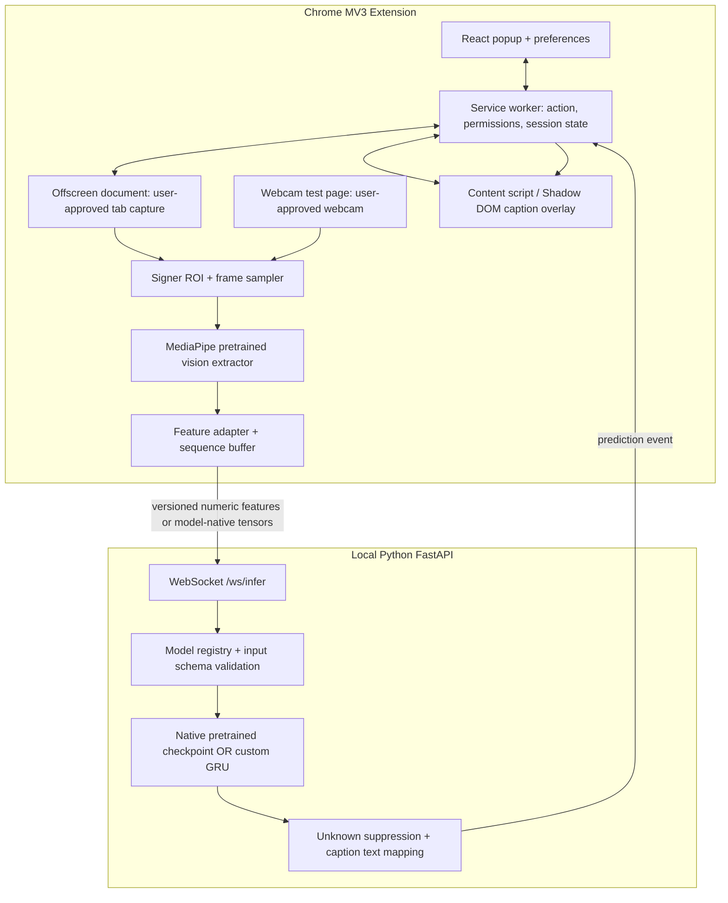
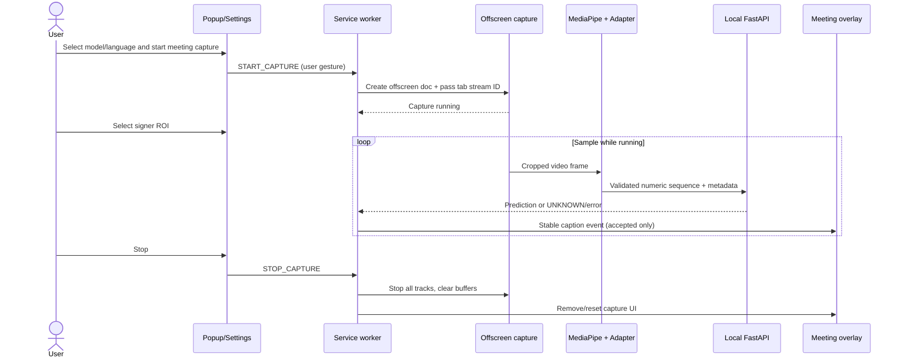

# 02 — Complete System Architecture

## High-level architecture

## Design decision: model adapter boundary
- **Adapter A (INCLUDE pretrained):** use preprocessing identical to AI4Bharat INCLUDE checkpoint. It may use MediaPipe Hands + BlazePose, but its exact keypoint ordering, channels, temporal sampling, augmentation and model input must be inspected from source; this is **not** guaranteed equal to our fallback schema.
- **Adapter B (Custom GRU):** use canonical 161-feature schema and `(32,161)` temporal sequence from `11-DATA-CONTRACTS.md`; model trained using same extractor.
- **Adapter C (WLASL):** use corresponding repository's video frames / keypoints and checkpoint head, under ASL label mapping.
- Model registry selects **one active pipeline at a time**. The chosen model metadata names `signed_language`, `input_schema_id`, `preprocess_version`, `num_classes`, `labels_hash`, and `checkpoint_sha256`.

## End-to-end sequence

## Data transfer and trust boundaries
1. **Meeting page**: untrusted DOM/video rendering; content scripts cannot assume durable page layout.
2. **Extension context**: trusted, but subject to MV3 service-worker suspension. Persist session metadata; don't assume globals survive.
3. **Local API**: boundary across localhost; validates Origin, session token and payload shape. Reject oversized and stale input.
4. **Model assets**: untrusted until source, model signature/shape, hash and license are checked.
5. **Data**: by default only numerical landmarks sent to localhost, not full frames. For a native video model, explicitly document the changed privacy boundary before adoption.

## Module map
| Module | Single responsibility | Fails safely when |
|---|---|---|
| Popup | configure and control session | no active tab, no backend |
| Service worker | session orchestration | suspended, tab removed |
| Offscreen document | capture stream and sample frames | media permission revoked |
| ROI selector | obtain signer crop coordinates | tile moves / resizes |
| Vision extractor | detect landmarks | hands or signer invisible |
| Feature adapter | model-specific feature schema | schema mismatch |
| Local inference API | authorized model inference | model missing, payload invalid |
| Postprocessor | UNKNOWN, dedup, gloss mapping | low confidence/no sign |
| Content overlay | visible, accessible local captions | unsupported page DOM |

## Deployment modes
- **Hackathon default:** unpacked Chrome extension + Python FastAPI on 127.0.0.1; no cloud requirements.
- **Later:** TFLite/ONNX entirely in extension only when benchmarked and privacy-reviewed.
- **Never imply:** a caption injected by a local content script propagates to all meeting attendees.

## Performance pipeline
Capture ROI at about 10–15 FPS (starting point), dynamically skip frames when busy; custom model uses 32 frames per window with an 8-frame stride. Predict, smooth, suppress duplicates, then render. These parameters are **tuning hypotheses, not proven latency claims**.
