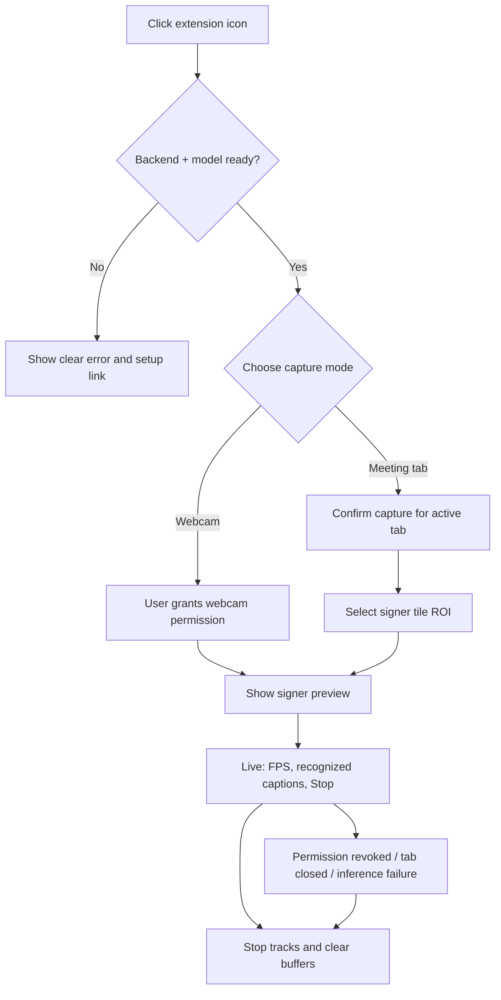

# 03 — UI / UX Design Flow

## Visual design intent
Accessible, modern, high-contrast professional product. No flashy animation during active capture; focus on clear state and fast access to **Stop**.

### Design tokens (proposal)
| Token | Value | Notes |
|---|---|---|
| Background | `#0B1120` | deep navy |
| Surface | `#111827` | dashboard cards |
| Primary | `#6366F1` | indigo action |
| Accent | `#22D3EE` | detection indicator |
| Positive | `#22C55E` | backend / model ready |
| Error | `#F87171` | capture/model failures |
| Text | `#F9FAFB` | primary text |
| Secondary text | `#CBD5E1` | descriptive text |
| Radius | 12–16 px | cards and overlay |

Do not use color alone to signal state; provide text and symbols. Obey prefers-reduced-motion. Avoid tiny captions.

## Screens
1. **Popup / compact dashboard:** backend status, model readiness, language selection, capture mode, start/stop button, link to settings.
2. **Settings:** caption language, font size, position, show-confidence, preferred model, privacy explanation.
3. **Webcam test page:** preview + skeleton toggle + FPS + model status; explicit webcam authorization.
4. **ROI picker in meeting tab:** user outlines signer tile, confirms crop, recalibrates after layout changes.
5. **In-page floating caption:** local caption/gloss, optional confidence, accessible controls (move/close).
6. **Diagnostics page (optional):** current pipeline, schema, backend, recent errors (no raw video/landmarks stored).

## UI flow


## UI component inventory
- `Header`, `LiveStatusPill`, `ModelSelector`, `LanguageSelector`, `CaptureModeSelector`, `StartStopControl`, `StatusCard`, `SettingsForm`, `PrivacyNotice`, `ROIPicker`, `CaptionOverlay`, `ErrorBanner`, `DiagnosticBadge`.
- Phase 1: components display **Not implemented** on capture and recognition, not simulated running states.
- Phase 2: enable webcam preview only after real camera + landmark tests.
- Phase 4: enable meeting capture only after user-gesture and cleanup tests.

## Caption design
- Use Shadow DOM for CSS isolation and an overlay rooted outside meeting controls.
- Default bottom-center with adjustable offset and draggable handle; never block critical buttons by default.
- Caption state machine: hidden → listening → accepted word → idle / error.
- Show short isolated glosses or explicitly validated phrase mapping; don't synthesize sentences or claim grammatical translation.
- Allow English/Hindi **written output mapping** only for supported verified glosses.
- Announce new captions through throttled `aria-live="polite"`; not every video frame.
- Keyboard-operable buttons, visible focus, escape/stop behavior and adequate touch targets.

## Suggested wireframe
```text
+-----------------------------------------------------+
| SignBridge AI                       Model: NOT READY |
| Recognition status: Idle        Backend: Connected   |
|-----------------------------------------------------|
| Mode: [Webcam] [Meeting tab]  Signed language: [ISL]|
| Model: [None available]                              |
|                                                     |
| [ Start Recognition — disabled until ready ]        |
| [ Settings ]  [ Privacy ]  [ Diagnostics ]           |
+-----------------------------------------------------+

Caption overlay (when real accepted sign arrives):
+--------------------------------------+
| Recognized: THANK_YOU                |
| धन्यवाद                             |
| [Move] [Close]                       |
+--------------------------------------+
```

## Text copy and honesty
- `MODEL_NOT_READY`: "Sign recognition model is not installed. No recognition is running."
- `WAITING_FOR_SIGNER`: "Select the signer video region to begin."
- `LOW_CONFIDENCE`: "Sign not recognized reliably" (optional settings panel; no fabricated caption).
- `CAPTURE_STOPPED`: "Capture stopped. No video is being processed."
