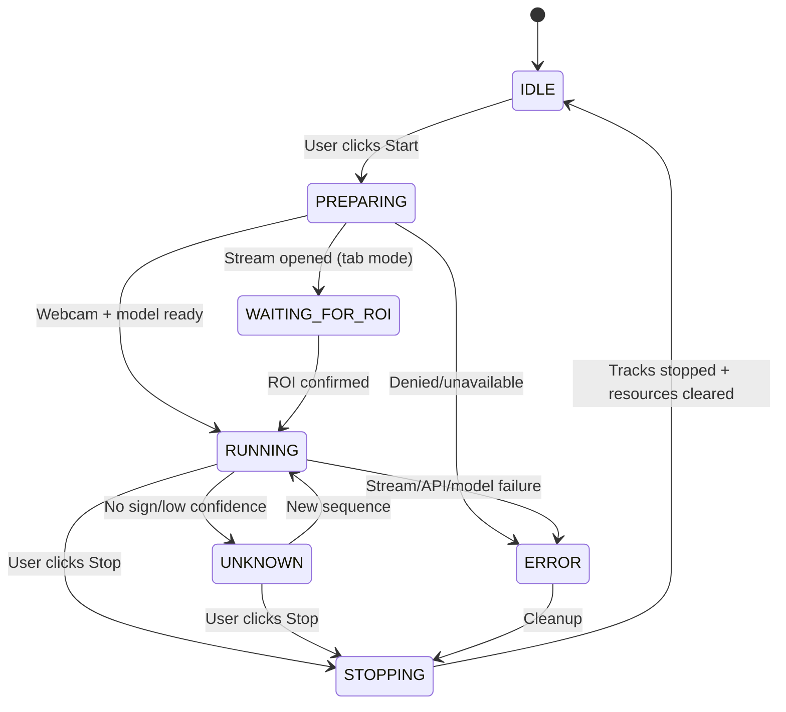
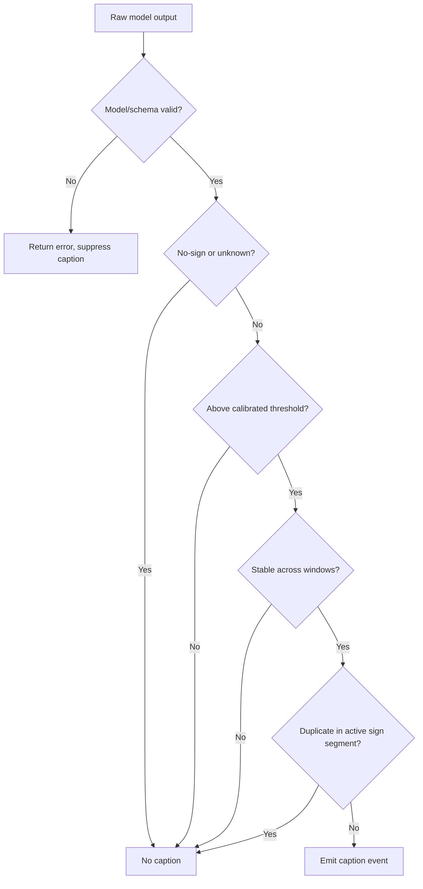

# 04 — End-to-End Working Flow

## Happy path: webcam
1. User starts local FastAPI backend and loads unpacked Chrome extension.
2. Popup checks `/health` and `/model/info`; displays actual readiness.
3. User opens Webcam Test, grants camera access in browser UI.
4. Video frames are sampled with timestamps; model-compatible extractor gets hand/pose landmarks.
5. Adapter generates a versioned feature sequence or native checkpoint input.
6. A validated payload reaches the local inference service.
7. Model outputs `label_id`, scores, `model_id`, `sequence_id` or explicit not-ready/error.
8. Postprocessor applies NONE/UNKNOWN strategy, temporal stability, cooldown and caption mapping.
9. In-page captions update only for stable accepted results; UI can show last label and delay metrics.
10. Stop revokes local processing, releases media tracks, clears temporal buffers and captions.

## Happy path: meeting tab
1. Participant opens supported meeting in Chrome. The user must approve capture for the current tab.
2. Action button **user gesture** requests tab stream ID; offscreen document consumes it.
3. User pins or enlarges the intended signer and selects a rectangular ROI on the rendered tab.
4. Frame sampler extracts ROI (no gallery-wide face detection, no default recording).
5. Each crop is passed through the same model-compatible preprocessing/inference/postprocess path.
6. Overlay appears in **the local viewer's Chrome tab only**. No automatic remote publishing.

## Capture → caption state machine

## Prediction acceptance

## Caption segmentation
Do not continually print "HELLO HELLO HELLO". New caption is allowed when a new sign event starts, or after a verified intervening `NO_SIGN`/transition. A fixed cooldown helps but cannot replace proper segment detection.

## Failure handling matrix
| Fault | User-facing response | Cleanup |
|---|---|---|
| Model not loaded | "Model not ready"; Start disabled | No stream opened |
| Camera denied | Actionable permission error | Release partial streams |
| Tab closed | "Capture ended" | Stop tracks and clear UI |
| ROI out of bounds | Ask to reselect | Pause processing |
| Backend offline | "Local inference disconnected" | Backoff, no captions |
| Schema mismatch | Show pipeline error/version | Reject predictions |
| Low sign confidence | No word emitted | Continue sampling |
| Hands not visible | Listening / unknown | Continue, don't infer word |
| Service worker sleeps | Recover from stored session facts | Offscreen controls stream |

## Asynchronous pipeline rules
- Never use an unbounded promise queue: at most one active feature extraction and a bounded pending inference window.
- Keep monotonically increasing `sequence_id` and timestamps; drop stale prediction responses.
- Measure `capture_timestamp_ms`, `request_timestamp_ms`, `response_timestamp_ms`, and `caption_display_timestamp_ms`.
- Use stable model config for an entire session; when changing language/model, stop and start a new session.
