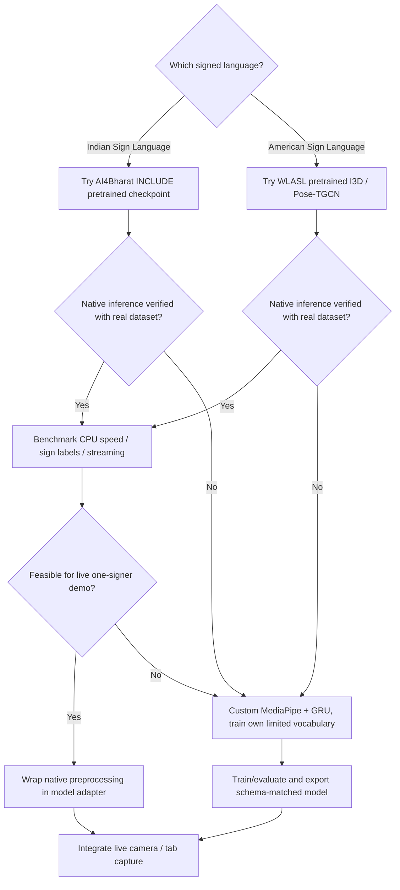

# 06 — Model Selection Decision Guide

## Recommended decision (India-focused hackathon)
**First benchmark a real pretrained ISL recognition model from AI4Bharat INCLUDE (especially INCLUDE-50 where appropriate), not a generic gesture model.** Use the model's native pipeline and test representative video clips on actual hardware. If checkpoint access, compatibility, or real-time performance blocks integration, switch to the controllable **MediaPipe Hands/Pose + custom GRU** pipeline trained on a verified limited vocabulary. For an ASL-only demo, evaluate WLASL pretrained I3D/Pose-TGCN instead.

This is not a guarantee that a third-party checkpoint will work with a Chrome extension; first complete a reproducible offline inference baseline.

## Decision tree

## Comparison matrix
| Option | Pretrained sign semantics? | Signed language | Input | Hackathon benefit | Main challenge | Recommendation |
|---|---|---|---|---|---|---|
| MediaPipe Holistic | **No** (landmarks only) | Not language-specific | RGB → landmarks | Browser-ready feature extractor | Needs sign classifier | **Use for features** |
| MediaPipe Hand Landmarker | **No** (landmarks only) | Not language-specific | RGB → hand landmarks | Lightweight baseline | Facial/body signs omitted | Quick camera prototype |
| MediaPipe Gesture Recognizer | **No general sign-language semantics** | Not a signed-language translator | RGB → a few predefined gestures | First camera smoke test | Few canned gestures | Never claim ASL/ISL translation |
| INCLUDE native pretrained model | **Yes**, isolated ISL baseline | ISL | Native keypoint/video input contract | Authentic ISL checkpoint+code | Original preprocessing/weight access | **First ISL evaluation** |
| WLASL I3D | **Yes**, isolated ASL baseline | ASL | Video clips, native preprocess | Authentic pretrained ASL weights | Heavier CPU/GPU, preprocessing | ASL-only evaluation |
| WLASL Pose-TGCN | **Yes**, isolated ASL baseline | ASL | Native pose/keypoints | Potentially lighter than video models | Native keypoint contract mismatch | ASL research baseline |
| Custom GRU (161 features) | **No until trained** | Depends on training dataset | `(32,161)` | Easiest controlled integration | Collect/train and validate | **Fallback demo** |

## Prioritized experiments
**E0: Smoke test** — local MediaPipe webcam landmarks. This proves only feature extraction.

**E1: INCLUDE-50 pretrained** — inspect repository, `pretrained_links.json`, model configuration, class list, dependencies, offline evaluation script. Check weights downloads genuinely succeed and inference matches reference metrics within environment constraints. Some `pretrained_links.json` entries are literally `"link"` placeholders; do not assume all URLs are usable.

**E2: Custom GRU** — prepare a lawful, limited labeled ISL dataset; compile exact feature schema from same runtime pipeline; train on held-out signers with NONE/UNKNOWN behavior.

**E3: WLASL** — optional alternate only for ASL if ISL path blocked, with language clearly labeled.

## Practical selection checklist
- [ ] Checkpoint file exists, checksum recorded, provenance documented.
- [ ] Licensing / commercial constraints reviewed, permission for dataset videos verified.
- [ ] Native reference inference runs on a *real* labeled video.
- [ ] Class labels match checkpoint output count and exact order.
- [ ] Input channel count, shape, coordinate definitions and temporal sampling inspected.
- [ ] Preprocessing reproduced exactly in streaming pipeline or delegated to native Python adapter.
- [ ] Real hardware CPU performance measured; user experience acceptable.
- [ ] UNKNOWN / NONE rejection characterized on non-sign activity.
- [ ] Unseen-signer split evaluated; no train/test subject leakage.
- [ ] Model card records signed language, warnings and metrics.

## Default product spec vs model research
Keep the product-level interfaces stable while evaluating models. `ModelAdapter` should be pluggable and self-describe schema, so selecting INCLUDE does not force the custom GRU format. If user explicitly requires a pretrained sign-trained checkpoint, choose native INCLUDE/WLASL and do not quietly substitute an untrained GRU.

## Scoring (qualitative, not benchmark results)
- ISL relevance: INCLUDE > ISL custom with proper data > WLASL ASL checkpoint.
- Low integration risk: custom MediaPipe feature schema + GRU > modifying existing INCLUDE/WLASL internals.
- Minimal extra training: verified INCLUDE/WLASL pretrained > custom GRU.
- Native browser-only potential: lightweight custom landmark classifier > full video I3D.

## Evidence
- https://github.com/AI4Bharat/INCLUDE
- https://github.com/AI4Bharat/INCLUDE/blob/master/pretrained_links.json
- https://github.com/dxli94/WLASL
- https://developers.google.com/edge/mediapipe/solutions/vision/holistic_landmarker
