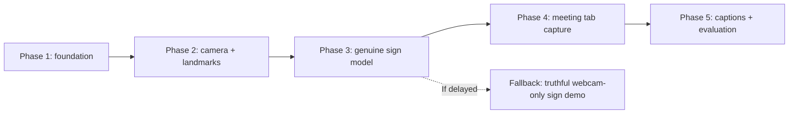

# 13 — Development Roadmap and Phase Gates

## Dependency chain

## Phase 1 — Foundation (requested current phase)
Deliver:
- Monorepo directories; React/TypeScript/Vite/Tailwind MV3 build; popup and settings.
- Service worker, content-script, offscreen entry **scaffold only**.
- FastAPI `GET /health` and `GET /model/info` with `not_loaded`.
- Typed event/message definitions and privacy notice.
- README, unit tests, `dist/` Chrome-loadable artifact with all referenced files.
**Do not:** request media, infer signs, display fabricated captions, pre-request excessive permissions.

Gate: `npm run build` passes; Chrome loads the extension; tests pass or remaining issues explicitly documented; backend responds truthfully.

## Phase 2 — Webcam + pretrained landmark tracking
Deliver:
- Real webcam preview with explicit user permission.
- Bundled MediaPipe Task model and WASM resources; version pinned.
- Handedness and 11 selected pose point schema, landmark visualization, FPS display.
- Normalized vector + temporal buffer for **custom GRU path**, and separately documented native model extraction if exploring INCLUDE.
- Golden test fixtures: same input → same features.

Gate: no fake landmarks; two-hand output and missing-hand masks tested; processing resource usage measured.

## Phase 3 — Pretrained sign model or custom classifier
Deliver:
- Attempt native AI4Bharat INCLUDE pretrained checkpoint baseline on **actual** ISL clips (for an ISL MVP).
- Audit model input shape, label order, license and real download availability.
- If native integration blocked, collect/curate verified sign classes and train custom GRU with stable fallback features.
- Model registry, manifest, loaded/not-loaded status, WebSocket inference and calibration/NO_SIGN.
- Signer-independent evaluation with confusion matrix and honest metrics.

Gate: one real sign clip yields a reproducible prediction through the actual model; low-confidence/unknown gestures do not automatically caption.

## Phase 4 — Meeting capture and selected ROI
Deliver:
- User-initiated tab capture, offscreen document stream handling, stop and cleanup.
- Pinned single-signer ROI selection and frame-sampling pathway.
- Model pipeline receives only selected ROI; backend disconnection and tab closure handled.
- Test Google Meet web first. Teams and Zoom web remain best-effort until validated.

Gate: real meeting-tab pixels reach feature extractor; Stop ends stream; no permission abuse; other attendees' captions are not falsely claimed.

## Phase 5 — Product integration, demo and release check
Deliver:
- Accept/unknown/dedup temporal logic, Shadow DOM captions, English/Hindi gloss mapping where verified.
- Full UX: settings, capture indicator, errors, keyboard access, font/position options.
- End-to-end browser test, latency and FPS measurements, privacy review, setup/docs.
- Demo with two devices and supported sign vocabulary.

Gate: all acceptance checks in `14-TESTING-AND-ACCEPTANCE.md` performed; failures/limitations stated transparently.

## Hackathon 48-hour illustrative allocation
| Time band | Focus | Stop/go |
|---|---|---|
| 0–4 h | P1 monorepo, manifest, backend | Chrome load and health pass |
| 4–10 h | P2 webcam + landmarks | Stable skeleton / FPS |
| 10–22 h | P3 checkpoint audit + offline inference; train backup if needed | **Real** sign recognition |
| 22–32 h | P4 tab capture + ROI | Actual meeting crop processed |
| 32–41 h | P5 captions + settings + error states | Local end-to-end success |
| 41–48 h | Eval, QA, demo, presentation | Honest results and fallback |

These are planning bands, **not promises**. Training/testing data availability is the largest schedule risk.

## Team responsibilities (four members)
- A: extension architecture, MV3, capture.
- B: sign model, dataset, checkpoint and validation.
- C: Python backend, schemas, streaming.
- D: UI/accessibility, integration tests, demo and documentation.

## Fallback scope ladder
If P3 checkpoint is blocked, **do not claim sign translation**: show live MediaPipe landmarks as technical progress, plus offline genuine sample predictions if available. If P4 is blocked, show webcam-only real recognition. If P5 text mapping is uncertain, display verified sign gloss only.
