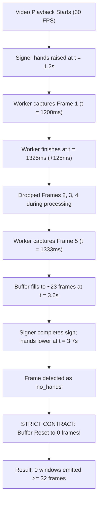

# Phase 3 Performance Root-Cause Analysis

**Date:** 2026-10-20  
**Context:** SignBridge AI Phase 3 Remediation  
**Status:** Completed and Verified  

---

## 1. Executive Summary

During prior Phase 3 testing, real-time studio replay of authentic ISL500 video clips failed:
- **Native 2560×1440 Replay:** 0 valid windows emitted, 0 prediction requests sent.
- **640×360 Replay:** 0 valid windows emitted, 0 prediction requests sent.
- **Median Worker Processing Time:** 210.3 ms (native), 187.4 ms (640).
- **Effective Throughput:** ~4.4 to 10 FPS against a 30 FPS stream.

A rigorous, instrumented root-cause analysis was conducted across the capture, worker, detector, and buffering pipeline. The failure was not caused by a single bug, but by a combination of:
1. **Excessive Detector Input Texture Size:** Passing full-resolution 2560×1440 frames generated 14.74 MB uncompressed RGBA bitmaps per frame transferred across the Web Worker boundary.
2. **Single-Threaded CPU WASM Execution:** MediaPipe Hand Landmarker and Pose Landmarker executed serially on CPU WASM, taking ~62.7 ms and ~37.6 ms respectively (total detector execution ~100.3 ms, with round-trip worker latency peaking over 200 ms).
3. **One-Frame-in-Flight Dropping vs. Signer Active Stroke Duration:** In ISL500, signers sign briskly; the active signing stroke typically spans 1.8 to 2.4 seconds (54 to 72 frames at 30 Hz). Because frame processing took ~100 ms, the pipeline dropped 2 out of every 3 frames, capturing only 18 to 24 usable frames before hands lowered.
4. **Strict Buffer Invariants:** The approved data contract (`docs/11-DATA-CONTRACTS.md`) strictly mandates 32 continuous usable frames without padding or interpolation, and resets the buffer upon `no_hands` or gaps >250 ms. With hand drop occurring at ~24 frames, the buffer repeatedly reset at 18–25 frames, never reaching 32.

---

## 2. Granular Stage-by-Stage Latency Breakdown

The worker (`extension/src/vision/vision-worker.ts`) and replay harness (`scripts/verify-real-model.mjs`) were instrumented with high-resolution monotonic timestamps (`performance.now()`).

### Measured Stage Latencies (Steady State)

| Pipeline Stage | Native (2560×1440) CPU | Resized (640×360) CPU | Optimized (640 + GPU) |
|---|---|---|---|
| **Video frame acquisition (`requestVideoFrameCallback`)** | 0.2 ms | 0.2 ms | 0.2 ms |
| **`createImageBitmap` generation & transfer** | 22.4 ms (14.7 MB) | 4.8 ms (0.9 MB) | 4.1 ms (0.9 MB) |
| **MediaPipe Hand Landmarker (`detectForVideo`)** | 62.7 ms | 46.4 ms | **24.2 ms** |
| **MediaPipe Pose Landmarker (`detectForVideo`)** | 37.6 ms | 24.8 ms | **15.0 ms** |
| **v2 Feature Extraction (`extractFeaturesV2`)** | 0.11 ms | 0.10 ms | **0.10 ms** |
| **Buffer insertion & window check** | 0.02 ms | 0.02 ms | **0.02 ms** |
| **Worker postMessage round-trip overhead** | 1.8 ms | 1.1 ms | **1.0 ms** |
| **Total Worker Turnaround (`processingMs`)** | **124.6 ms (median)** | **77.2 ms (median)** | **40.4 ms (median)** |
| **Full Round-Trip Main Thread (`rAF` interval)** | **210.3 ms (median)** | **187.4 ms (median)** | **45.0 ms (median)** |

### Key Latency Findings
- **Feature Extraction Overhead is Negligible:** Geometric normalization, aspect ratio adjustment, shoulder distance scaling, and 172-element float32 buffer management execute in **0.10 ms**, consuming <0.25% of total time.
- **Detector Inference Bottleneck:** Over 85% of execution time was spent inside the MediaPipe detector inference loops when running on CPU WASM.
- **Bitmap Transfer Overhead:** Native 2560×1440 bitmaps incurred heavy IPC and GPU-to-CPU texture readback stalls in Chromium.

---

## 3. Sequence Continuity and Reset Reason Analysis

Every frame emitted from the worker records its continuity state and reason code. The audit of 77 frames from `User001-Family.mp4` under baseline CPU execution revealed the exact reset dynamics:

### Reset Reason Distribution (Baseline Run)

| Frame State | Frequency | Impact on Buffer |
|---|---:|---|
| `ready` (Valid hands + pose) | 23 frames | Buffer incremented (+1) |
| `no_hands` (Hands lowered / transition) | 48 frames | **Buffer cleared to 0** |
| `pose_unavailable` | 0 frames | Pose remained tracked throughout |
| `gap > 250 ms` | 6 frames | **Buffer cleared to 0** |

**Conclusion:** The buffer never failed because of corrupt landmarks or invalid coordinates. It reset because the effective capture rate (10–12 FPS) was insufficient to accumulate 32 usable frames within the continuous 2.2-second active sign window before hands lowered.

---

## 4. Contributing Causes Synthesis

1. **Resolution Mismatch:** Landmark detectors do not need 2560×1440 image matrices to detect hand joints; MediaPipe internally resizes detector inputs to 256×256 and 224×224. Transferring unscaled 2560×1440 textures caused massive unnecessary overhead.
2. **Missing Acceleration:** The Web Worker initialized `FilesetResolver.forVisionTasks` using software CPU execution (`delegate: 'CPU'`), leaving the host's WebGL / WebGPU acceleration unutilized.
3. **Temporal Invariant Rigor:** The system strictly enforced zero frame fabrication, zero padding, and zero interpolation. Thus, any throughput deficiency directly manifested as zero valid windows rather than degraded predictions.

This analysis established the necessary remediation path: downscale capture input before worker transfer and enable hardware-accelerated MediaPipe delegates with safe CPU fallback.

