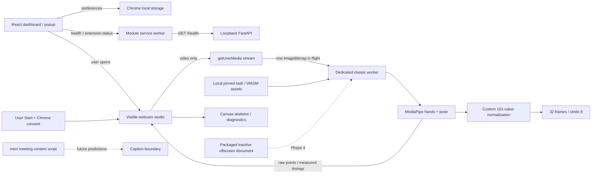

# Architecture

Phase 2 adds a visible webcam studio alongside the Phase 1 foundation.

## Ownership and consent

The studio is a dedicated extension tab, not the popup. Opening it does not request
media. Start acquires a Web Lock scoped to the extension and requests video only.
A second studio cannot capture concurrently. A generation token cancels delayed
permission, model-loading and bitmap promises. Late streams are stopped; late
bitmaps are closed. Stop, Esc, hidden document, pagehide, unmount, disconnected
track or processing error releases tracks, worker, timers, animation loop and lock.
The worker is terminated, reclaiming WASM and buffer ownership; no data is retained.
Model loading has a 30-second timeout; in-flight detection has a 10-second timeout.

Sampling is capped at 15 FPS, skips repeated video times and never queues a second
bitmap. CPU detection runs outside the React/UI thread. The canvas and video mirror
together without changing detector input. Raw frames and features are memory-only.
No microphone, recording, backend upload, sign inference or captions exist.

## Existing boundaries

The module service worker registers message listeners synchronously. Only the
trusted dashboard can request its bounded loopback health fetch. Preferences are
durable; worker globals are not. Extension status refers users to the studio for
camera state rather than falsely claiming all studio tabs are inactive.

Content scripts remain inert on declared Meet/Teams/Zoom origins; they do not
read meeting content or alter native controls. The packaged offscreen page remains
inactive with no offscreen/tabCapture permission. FastAPI remains a phase-1,
loopback-only health/model-info service with explicit preview CORS, trusted-host
checks and no prediction endpoint. Model readiness describes the sign classifier.

## Data and messages

[11-DATA-CONTRACTS.md](11-DATA-CONTRACTS.md) defines the approved custom GRU schema.
It is not an INCLUDE/WLASL adapter. Private dedicated-worker messages are defined
in `vision/protocol.ts`; runtime `GET_STATUS` and `CHECK_BACKEND` remain implemented,
while reserved meeting-capture and sign-inference commands return `NOT_IMPLEMENTED`.
The worker chooses fixed asset URLs and never accepts model paths from page content.
No private worker is exposed to a website or content-script message bridge.

## Packaging

Vite builds dashboard, webcam, offscreen HTML and module service worker. Separate
IIFE builds emit classic `content.js` and `vision-worker.js`; the latter supports
MediaPipe's local importScripts loader. The build verifies asset hashes, local
imports, CSP, icons, production React and classic-script syntax. The sole computed
import exception is the pinned MediaPipe loader inside that worker; it receives a
fixed local base path. `script-src 'self' 'wasm-unsafe-eval'` permits local WASM,
not JavaScript eval or remote executable code. No web-accessible resources exist.

Phase 4 must separately implement explicit meeting selection, ROI and stream
lifecycle before changing tabCapture/offscreen permissions. Nothing automatically
joins a meeting. Future overlays must use Shadow DOM and genuine predictions.
